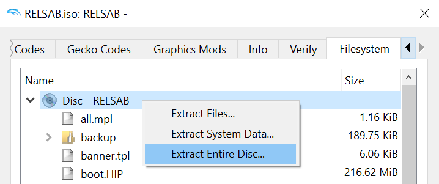

Ratatouille (Jan 18, 2006 prototype)  
[![Build Status]][actions] <!--[![Code Progress]][progress] [![Data Progress]][progress]--> [![Discord Badge]][discord]
=============

[Build Status]: https://github.com/seilc/rat/actions/workflows/build.yml/badge.svg
[actions]: https://github.com/seilc/rat/actions/workflows/build.yml
<!--
decomp.dev progress badges (hidden until the project is registered on decomp.dev)
See https://decomp.dev/api for an API overview.
-->
[Code Progress]: https://decomp.dev/seilc/rat.svg?mode=shield&measure=code&label=Code
[Data Progress]: https://decomp.dev/seilc/rat.svg?mode=shield&measure=data&label=Data
[progress]: https://decomp.dev/seilc/rat
[Discord Badge]: https://img.shields.io/discord/829152115322257436?color=%237289DA&logo=discord&logoColor=%23FFFFFF
[discord]: https://discord.gg/dVbGFdYU6A

A work-in-progress decompilation of [Ratatouille (Jan 18, 2006 prototype)](https://hiddenpalace.org/Disney-Pixar_Ratatouille_(Jan_18,_2006_prototype)).

This repository does **not** contain any game assets or assembly whatsoever. An existing copy of the game is required.

Full disclosure: code matched before October 21, 2026 was decompiled by hand. Since then, the project has been
AI-assisted: new code is decompiled with the help of an LLM, then reviewed and checked against the original binaries.
Matching code is byte-identical to the original, but names, types and source structure beyond what the binaries
and their debug info prove may be guesses.

Supported versions:

- `DEBUG` - ratsgc_d.elf
- `RELEASE` - ratsgc_r.elf
- `MASTERDEBUG` - ratsgc_md.elf
- `MASTER` - ratsgc_m.elf

Dependencies
============

Windows
--------

On Windows, it's **highly recommended** to use native tooling. WSL or msys2 are **not** required.  
When running under WSL, [objdiff](#diffing) is unable to get filesystem notifications for automatic rebuilds.

- Install [Python](https://www.python.org/downloads/) and add it to `%PATH%`.
  - Also available from the [Windows Store](https://apps.microsoft.com/store/detail/python-311/9NRWMJP3717K).
- Download [ninja](https://github.com/ninja-build/ninja/releases) and add it to `%PATH%`.
  - Quick install via pip: `pip install ninja`

macOS
------

- Install [ninja](https://github.com/ninja-build/ninja/wiki/Pre-built-Ninja-packages):

  ```sh
  brew install ninja
  ```

- Install [wine-crossover](https://github.com/Gcenx/homebrew-wine):

  ```sh
  brew install --cask --no-quarantine gcenx/wine/wine-crossover
  ```

After OS upgrades, if macOS complains about `Wine Crossover.app` being unverified, you can unquarantine it using:

```sh
sudo xattr -rd com.apple.quarantine '/Applications/Wine Crossover.app'
```

Linux
------

- Install [ninja](https://github.com/ninja-build/ninja/wiki/Pre-built-Ninja-packages).
- For non-x86(_64) platforms: Install wine from your package manager.
  - For x86(_64), [wibo](https://github.com/decompals/wibo), a minimal 32-bit Windows binary wrapper, will be automatically downloaded and used.

Building
========

- Clone the repository:

  ```sh
  git clone https://github.com/seilweiss/rat.git
  ```

- Using [Dolphin Emulator](https://dolphin-emu.org/), extract your game to `orig/RELSAB`.

  - To save space, the only necessary files are the following. Any others can be deleted.
    - `files/ratsgc_d.elf`
    - `files/ratsgc_m.elf`
    - `files/ratsgc_md.elf`
    - `files/ratsgc_r.elf`
- Configure:

  ```sh
  python configure.py -v VERSION
  ```
  Replace `VERSION` with `DEBUG`, `RELEASE`, `MASTERDEBUG`, or `MASTER`.

- Build:

  ```sh
  ninja
  ```

Code style
==========

The game code is formatted by hand, not by clang-format, and some of it looks inconsistent on purpose. The DEBUG
build's debug info records which source line each piece of code came from, so the layout follows it where it can: a loop or
`if` written on one line without braces, several statements on one line, or brace style changing within a file
usually reflect which statements shared a line in the original source. Assert conditions are spelled exactly as
in the original binary's assert strings (`0==xSTFindAsset(...)`), since the compiler stringifies them.

Please don't run an auto-formatter over the C/C++ source. New code follows the surrounding code: 4-space indent,
function braces on their own line, control-statement braces on the same line.

Diffing
=======

Once the initial build succeeds, an `objdiff.json` should exist in the project root.

Download the latest release from [encounter/objdiff](https://github.com/encounter/objdiff). Under project settings, set `Project directory`. The configuration should be loaded automatically.

Select an object from the left sidebar to begin diffing. Changes to the project will rebuild automatically: changes to source files, headers, `configure.py`, `splits.txt` or `symbols.txt`.


